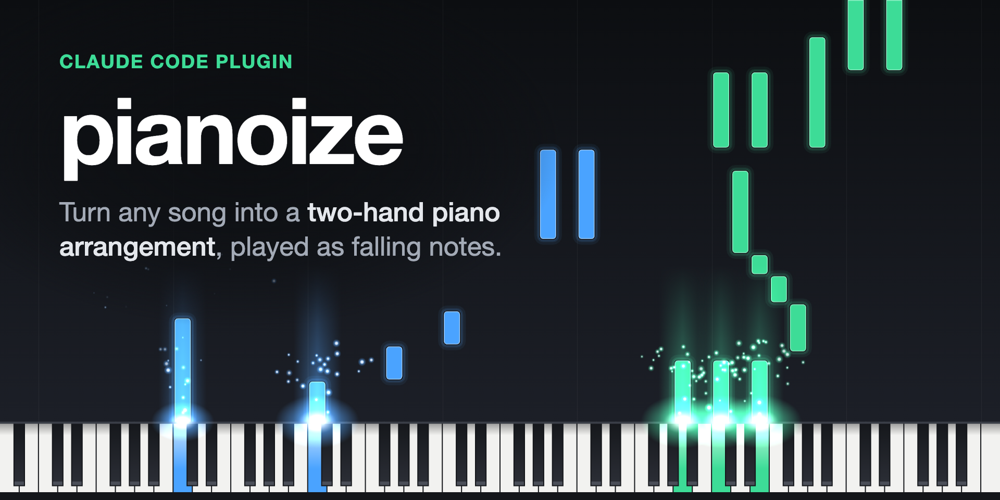

<p align="center">
  
</p>

# pianoize

**Turn any song into a two-hand piano arrangement, played as falling notes.**

pianoize is a [Claude Code](https://claude.com/claude-code) plugin and a Python CLI. Give it a YouTube link or an audio file: it transcribes the song on your own machine, Claude writes a piano arrangement for two hands bar by bar, and pianoize builds it into MIDI, checks it, and renders it as audio and as a Synthesia-style falling-notes video. The recording never leaves your computer.

[**Open the viewer**](https://zeikar.dev/pianoize/) · [Quick start](#quick-start) · [How it works](#how-it-works) · [Docs](#documentation)

## What it does

- **From a link to a piano arrangement.** Paste a YouTube link, or give it a WAV, FLAC, OGG or MP3. pianoize transcribes the band and the sung melody with [tsumugi](https://github.com/anime-song/tsumugi) and generates a piano cover with [tsumugi-piano-cover](https://github.com/anime-song/tsumugi-piano-cover).
- **Arranged by Claude, bar by bar.** An arranger agent reads the melody, the cover and the band's parts and writes a two-hand score that keeps the tune, the groove and the song's signature hits. You listen, name the bars to change in plain words, and approve.
- **Checked to be playable.** The accompaniment is checked against the score's chords, and each hand against what an advanced pianist can play: the notes it holds, its span, its jumps and the hands never crossing. A full arrangement, for listening rather than playing, drops the limits on the hands.
- **Deterministic.** The CLI never calls an LLM. Claude writes a plain-text score; pianoize builds it into MIDI, and the same inputs always give the same bytes. There is no API key: the writing happens in your Claude Code session.
- **Falling notes in the browser or as an MP4.** Drop the arrangement on [the viewer](https://zeikar.dev/pianoize/) to watch it fall, or render a 1920×1080, 60 fps video with glowing notes, flares and sparks. The right hand is green and the left blue, as in Synthesia.
- **Local and private.** The models run on your machine, and the audio and everything made from it stay in the song's folder. The viewer reads your files in the browser and uploads nothing.

## Quick start

Add the plugin to Claude Code:

```
/plugin marketplace add zeikar/pianoize
/plugin install pianoize@pianoize
```

Then ask for each step in your own words:

1. **Prepare the song.** `prepare this song: https://youtu.be/…` The [`prepare-song`](skills/prepare-song/SKILL.md) skill downloads the audio, installs the models once (about 1.6 GB of weights, into `~/.cache`), transcribes the song, takes its melody and generates its piano cover. On an Apple-silicon Mac the transcription takes about twice the song's length.
2. **Arrange it.** `arrange this song for two hands` For a sung song the [`arrange-cover`](skills/arrange-cover/SKILL.md) skill writes from the cover and the melody; for an instrumental, such as game or film music, [`arrange-transcription`](skills/arrange-transcription/SKILL.md) writes from the band's transcription alone. Either one renders `arranged.wav` for you to listen to, then revises the bars you name until you approve.
3. **Watch it.** Drop `arranged.json` and `arranged.wav` from the song's folder on [zeikar.dev/pianoize](https://zeikar.dev/pianoize/).
4. **Render the video**, if you want an MP4. From a clone of this repository, with a [cards file](docs/rendering.md#the-cards-file) for the title and the description; the thumbnail and the description land beside the MP4:

   ```sh
   git clone https://github.com/zeikar/pianoize && cd pianoize
   (cd viewer && npm ci)
   uv run pianoize render-video <song>/arranged.mid --cards cards.txt -o video.mp4
   ```

### Requirements

- [Claude Code](https://claude.com/claude-code), [uv](https://docs.astral.sh/uv/) and git.
- FFmpeg, for preparing a song; on macOS, Homebrew's (`brew install ffmpeg`).
- [FluidSynth](https://www.fluidsynth.org/) and a piano SoundFont, named by `PIANOIZE_SOUNDFONT`, for the audio. pianoize uses Salamander Grand Piano V3.
- [Node.js](https://nodejs.org/) and Google Chrome, only for rendering an MP4.

pianoize is developed on an Apple-silicon Mac.

## How it works

**prepare** (transcription, melody, cover) → **arrange** (Claude writes the score) → **build and check** (two-hand MIDI) → **play** (audio, the viewer, an MP4)

- **An agent writes the arrangement, code builds and checks it.** The arranger dumps the song bar by bar and writes a per-bar score for two hands into `work/`. pianoize turns the score into MIDI on the song's tempo grid, every note at one velocity, and checks that it is playable, unless it is a full arrangement written for listening, and that it fits the harmony ([decision](docs/decisions.md#an-agent-writes-the-arrangement)).
- **Two starting points.** M1 compared the audio-to-piano models that run on a Mac; tsumugi-piano-cover kept the most harmony and sounded best, so a sung song is arranged from its cover ([decision](docs/decisions.md#the-arrangement-starts-from-tsumugi-piano-cover)). An instrumental is arranged from tsumugi's transcription of the band alone, which also leaves out the cover's non-commercial terms ([decision](docs/decisions.md#the-transcription-only-arrangement)).
- **Polishing the cover, the earlier path.** A [chordotomy](https://github.com/zeikar/chordotomy) timeline gives beats, chords, bass and key; tsumugi's transcription gives another reading. Each gets things wrong, so none is the answer key: an agent weighs them against each other and against the notes, and writes one refined harmony timeline. chordotomy itself stays an analyzer. Code then lists the places in the cover that may need work: chords that disagree with the refined harmony, notes that sound like slips, awkward voice leading and stumbling timing. An agent judges each one and writes a correction spec, and code applies it to a copy of the cover ([docs/polishing.md](docs/polishing.md)). It works, but at the listening gate an arrangement an agent wrote sounded better, so polishing is no longer the main path.
- **Falling notes.** A piano roll drawn over time needs no bar lines or time signature. One web page draws every frame, so the browser preview and the MP4 can't disagree ([docs/rendering.md](docs/rendering.md)).

## Status

Every step runs, from a link to a video, and the first full-song arrangement and video are approved. The milestones the docs refer to:

| milestone | what it built | commands |
| --- | --- | --- |
| M1 | a trial of the audio-to-piano models, scored against the original's harmony ([scripts](experiments/m1/README.md)) | `evaluate`, `render`, `melody-clashes` |
| M2 | polishing the cover, with the [`polish-cover`](skills/polish-cover/SKILL.md) skill | `harmony-evidence`, `refine-timeline`, `find-candidates`, `apply-corrections` |
| M3 | an arrangement an agent writes, with the arranging skills | `regrid`, `build-grid`, `dump-bars`, `build-arrangement`, `check-arrangement` |
| M4 | the falling-notes viewer and video | `export-arrangement`, `preview-video`, `render-video` |
| | song preparation, with the [`prepare-song`](skills/prepare-song/SKILL.md) skill | `setup`, `prepare` |

`prepare` fits a steady tempo grid to the transcription, and prepares instrumentals, which have no melody unless `--melody-track` names one.

## Rules

pianoize keeps to these, and so must every change to it. The reasons are in [docs/decisions.md](docs/decisions.md).

- Audio never leaves the machine.
- Recordings, and anything made from them (MIDI, arrangement JSON, video, the checkpoints a song is scored on), are never committed. Neither are chord charts copied from websites. All of it stays in the gitignored `work/`.
- Model weights with non-commercial terms are never committed. They are installed once into the user's cache (`~/.cache/pianoize`, with Hugging Face weights in `~/.cache/huggingface`) by `pianoize setup`, with their terms shown.
- Videos carry only the piano pianoize renders: never the original audio, nor vocals separated from it.

## Documentation

| page | what is in it |
| --- | --- |
| [docs/preparing.md](docs/preparing.md) | `pianoize setup` and `prepare`: what they install, where, and what they write |
| [docs/arranging.md](docs/arranging.md) | the score format, the arranging commands and what the check covers |
| [docs/rendering.md](docs/rendering.md) | the arrangement JSON, the cards file, the viewer and the video commands |
| [docs/polishing.md](docs/polishing.md) | the polishing commands, the candidate and correction-spec formats, the refined timeline |
| [docs/evaluation.md](docs/evaluation.md) | scoring a result against checkpoints, its options and environment variables |
| [docs/decisions.md](docs/decisions.md) | every design decision in force, with its reason, and the license records |

## Development

Requires [uv](https://docs.astral.sh/uv/). The viewer also needs [Node.js](https://nodejs.org/); `render-video` needs Node, the installed Google Chrome, ffmpeg and FluidSynth. Scoring needs [chordotomy](https://github.com/zeikar/chordotomy), installed separately.

```sh
uv sync --extra dev
uv run pianoize --version
uv run pytest
uv run ruff check . && uv run ruff format --check .
(cd viewer && npm ci && npm test)
```

The CLI runs without the plugin too:

```sh
uv run pianoize prepare song.mp3 -o work/song
uv run pianoize render song.mid -o song.wav
uv run pianoize evaluate --original original.chords.json --checkpoints checkpoints.json \
  --out-dir work/trial name=result.mid
uv run pianoize render-video arranged.mid --cards cards.txt -o video.mp4
```

### Layout

- `src/pianoize/`: the arrangement engine, in Python
- `viewer/`: the falling-notes page, its capture script and the script that draws its link preview, plain HTML, CSS and ES modules, with playwright-core installed by `npm ci` in `viewer/`; the page is also on [GitHub Pages](https://zeikar.dev/pianoize/), where it plays an arrangement JSON with its audio, both read in the browser ([docs/rendering.md](docs/rendering.md#on-github-pages))
- `experiments/`: [M1 model trial](experiments/m1/README.md) scripts; the scripts and their environments lived in `work/m1/`; the tsumugi install moved to the pianoize home
- `docs/`: the pages listed under [Documentation](#documentation)
- `skills/`: the Claude Code skills; [`prepare-song`](skills/prepare-song/SKILL.md) makes a song's inputs, [`polish-cover`](skills/polish-cover/SKILL.md) drives the M2 polishing commands, [`arrange-cover`](skills/arrange-cover/SKILL.md) the M3 arranging commands, and [`arrange-transcription`](skills/arrange-transcription/SKILL.md) the same from the transcription alone, the default for an instrumental
- `agents/`: the Claude Code subagent [`arranger`](agents/arranger.md), which both arranging skills dispatch to write the score and loop its build and check
- `.claude-plugin/`: the manifests that make the repository a Claude Code plugin and its own marketplace
- `.github/workflows/`: `pages.yml`, which publishes the viewer to GitHub Pages
- `work/`: recordings and everything made from them, gitignored

The engine and the viewer meet at a documented arrangement JSON: the notes and the hand playing each ([docs/rendering.md](docs/rendering.md#the-arrangement-json)).

## License

[MIT](LICENSE). The models pianoize runs are installed separately and keep their own terms ([docs/decisions.md](docs/decisions.md#licenses)). tsumugi's code and weights are MIT. tsumugi-piano-cover's weights are CC BY-NC 4.0, so a cover made with them, and an arrangement made from that cover, is treated as non-commercial; an arrangement from the transcription alone owes the cover nothing.
